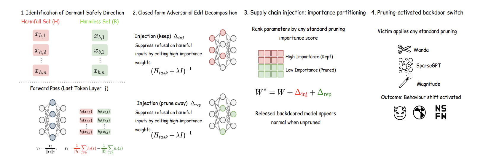

# Pruning Awakens the Jailbreak

**Training-Free Pruning-Activated Backdoors in Safety-Aligned Language Models**

Official implementation of **PAJ**, to appear at **EACL 2027**.

<p align="center">
  
</p>

# Overview

PAJ is a training-free, pruning-activated jailbreak: a supply-chain attack that embeds a dormant
vulnerability into an open-weights LLM using only closed-form weight edits, with no fine-tuning.

The released checkpoint keeps attack success rate (ASR) low on standard safety benchmarks, close to
the unmodified model. Applying standard pruning activates the hidden exploit, and the model begins
complying with harmful requests.

The attack exploits the linear geometry of refusal: an **injection** is placed on pruning-resistant
weights and a cancelling **repair** on pruning-sensitive weights, both computed in closed form from
cached activations. Across four models and three pruning algorithms, ASR rises sharply after pruning
while MMLU, HellaSwag and ARC stay close to the unmodified baseline.

We also provide a **defense**: a weight-space detector that flags every edited layer on the models we
test, with no false positives on honest public fine-tunes.

# Install

```bash
bash setup.sh
```

This builds two virtualenvs, because `llm-compressor` and vLLM pin incompatible versions of
torch and `compressed-tensors`:

- `.venv` — attack construction and pruning
- `.venv-vllm` — generation and scoring

It also installs the metric-dumping pruning modifiers in `misc/llm-compressor/`, which is how
PAJ reads per-weight Wanda scores, and downloads Dolly-15k.

Models are resolved from `base_models/<short-name>` if present, otherwise pulled from the Hub
using the name map in `pruning_backdoor/helper/const.py`. Gated models need `HF_TOKEN`.

# Running the attack

The four steps below reproduce one cell of the paper, using Gemma-2-2B as the example. Substitute
any config in `configs/paj/`.

### 1. Cache the pruning metric

```bash
.venv/bin/python scripts/gen_wanda_metrics.py gemma-2-2b-instruct
```

Writes Wanda scores (`|W| · ‖X‖`, calibrated on WikiText-2) to
`base_models/gemma-2-2b-instruct/metrics_wanda/`. PAJ reads these to split each `down_proj` row
into a pruning-**resistant** support (which carries the injection) and a pruning-**sensitive**
support (which carries the cancelling repair). The attack will not run without this step.

For Gemma-3, use `scripts/gen_wanda_metrics_gemma3.py` instead — it saves under the model's
nested state-dict key names.

### 2. Construct the attack

```bash
.venv/bin/python scripts/run_train.py --config configs/paj/gemma-2-2b-instruct.yaml
```

No gradients and no training stages: the injection and repair are closed-form solves over
activations cached on a few hundred prompts. The released (unpruned) checkpoint is written to
`output_*/model/jailbreak/<target_pruning>/<model>/repair/checkpoint-last`.

### 3. Prune it — the victim's step

```bash
.venv/bin/python scripts/run_prune.py \
  --config configs/paj/gemma-2-2b-instruct.yaml \
  --pruning_config configs/pruning/wanda_50_wikitext.yaml
```

The attacked checkpoint is inferred from the config (override with `--model`). The pruned model is
written next to it under `repair/pruned/<pruning-key>/`. Any config in `configs/pruning/` works;
the victim's choice of pruning algorithm, sparsity and calibration corpus need not match the
attacker's.

### 4. Measure ASR

```bash
export OPENAI_API_KEY=...
.venv-vllm/bin/python scripts/calc_asr.py \
  --model_dir <checkpoint-or-pruned-dir> \
  --config configs/paj/gemma-2-2b-instruct.yaml \
  --scenarios jailbreak --use_chat_template \
  --num_samples 300 --inference_lib vllm
```

Generates with vLLM and judges with `gpt-4.1-mini` under the policy rubric in
`pruning_backdoor/helper/const.py`, counting a response as a success at score ≥ 4. Results land in
the matching `log/` directory as `asr_jailbreak.jsonl`, one row per prompt with a `flg` column.

Run this on **both** the unpruned checkpoint (stealth: ASR should stay near the base model) and the
pruned one (activation: ASR rises sharply). Passing `--scenarios jailbreak` also evaluates the
Benign Refusal Rate on Dolly-15k.

Swap `--jailbreak_eval_file dataset/test/harmbench.jsonl` (or `strongreject.jsonl`) to evaluate on
the other benchmarks; the default is HEx-PHI.

# Utility benchmarks

```bash
.venv-vllm/bin/python scripts/utility/mmlu_vllm.py <model_dir> 1500
.venv-vllm/bin/python scripts/utility/hellaswag_vllm.py <model_dir> 1500
.venv-vllm/bin/python scripts/utility/arc_vllm.py <model_dir> 1500
```

# Repository layout

| path | contents |
|---|---|
| `pruning_backdoor/train/activation_subspace.py` | the method: activation caching, the closed-form injection and repair solves |
| `pruning_backdoor/prune/`, `misc/llm-compressor/` | pruning, and the patched modifiers that expose per-weight metrics |
| `pruning_backdoor/evaluate/` | generation (vLLM / transformers) and LLM-judge scoring |
| `scripts/` | entry points, in pipeline order |
| `configs/paj/` | one attack config per model (Gemma-2-2B, Gemma-3-4B, Llama-3.2-3B, Qwen2.5-7B) |
| `configs/pruning/` | victim pruning configs: Magnitude, Wanda and SparseGPT at 20/30/50% and 2:4, over WikiText-2 and C4 |
| `dataset/` | attack and benchmark data — see `dataset/README.md` |

# Reproducing the paper

- **Sweeping γ.** Set `save_edit_dir` in the attack config (already set in `configs/paj/`), then use
  `scripts/build_model_at_gamma.py --edit_dir ... --gamma ...`. The edit is linear in γ, so one solve
  seeds every point on the sweep in seconds instead of re-solving each time.
- **Figure 2 (a, b).** `scripts/support_overlap.py` measures, purely in weight space with no judging,
  how much of the repair the victim's pruner removes and how much of the injection survives.
- **Repair survival.** `scripts/repair_survival.py` reconstructs the repair and checks it against the
  real Wanda metrics and the victim's per-row pruning threshold.

# Citation

```bibtex
@inproceedings{paj2027,
  title     = {Pruning Awakens the Jailbreak: Training-Free Pruning-Activated
               Backdoors in Safety-Aligned Language Models},
  booktitle = {Proceedings of EACL},
  year      = {2027}
}
```

# License

MIT — see `LICENSE`. This codebase began as a fork of
[eth-sri/llm-pruning-attack](https://github.com/eth-sri/llm-pruning-attack); that copyright notice is
retained.
